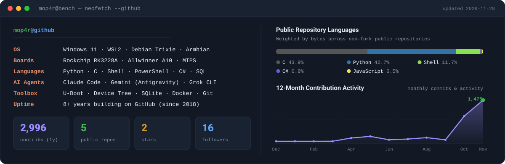
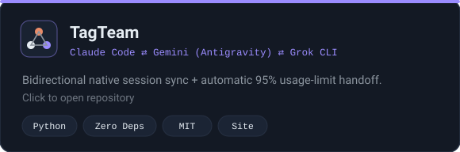
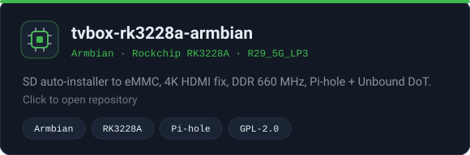
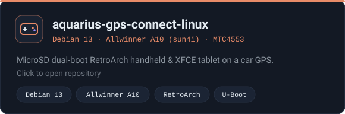
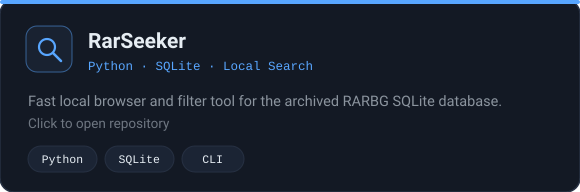

  <picture>
    <source media="(prefers-color-scheme: dark)" srcset="assets/hero-dark.svg">
    <source media="(prefers-color-scheme: light)" srcset="assets/hero-light.svg">
    
  </picture>

  <picture>
    <source media="(prefers-color-scheme: dark)" srcset="assets/terminal-dark.svg">
    <source media="(prefers-color-scheme: light)" srcset="assets/terminal-light.svg">
    
  </picture>

## Featured Projects

<table>
  <tr>
    <td width="50%">
      <a href="https://github.com/mop4r/tagteam">
        <picture>
          <source media="(prefers-color-scheme: dark)" srcset="assets/card-tagteam-dark.svg">
          <source media="(prefers-color-scheme: light)" srcset="assets/card-tagteam-light.svg">
          
        </picture>
      </a>
    </td>
    <td width="50%">
      <a href="https://github.com/mop4r/tvbox-rk3228a-armbian">
        <picture>
          <source media="(prefers-color-scheme: dark)" srcset="assets/card-tvbox-dark.svg">
          <source media="(prefers-color-scheme: light)" srcset="assets/card-tvbox-light.svg">
          
        </picture>
      </a>
    </td>
  </tr>
  <tr>
    <td width="50%">
      <a href="https://github.com/mop4r/aquarius-gps-connect-linux">
        <picture>
          <source media="(prefers-color-scheme: dark)" srcset="assets/card-aquarius-dark.svg">
          <source media="(prefers-color-scheme: light)" srcset="assets/card-aquarius-light.svg">
          
        </picture>
      </a>
    </td>
    <td width="50%">
      <a href="https://github.com/mop4r/RarSeeker">
        <picture>
          <source media="(prefers-color-scheme: dark)" srcset="assets/card-rarseeker-dark.svg">
          <source media="(prefers-color-scheme: light)" srcset="assets/card-rarseeker-light.svg">
          
        </picture>
      </a>
    </td>
  </tr>
</table>

| Project | Stack & Hardware | Links |
|---|---|---|
| [**TagTeam**](https://github.com/mop4r/tagteam) | Python (zero deps) · Claude Code · Gemini (Antigravity / `agy`) · Grok CLI | [Repo](https://github.com/mop4r/tagteam) · [Site](https://mop4r.github.io/tagteam/) · [Release](https://github.com/mop4r/tagteam/releases) |
| [**tvbox-rk3228a-armbian**](https://github.com/mop4r/tvbox-rk3228a-armbian) | Armbian · Debian Trixie · Rockchip RK3228A (`R29_5G_LP3`) · Pi-hole + Unbound DoT | [Repo](https://github.com/mop4r/tvbox-rk3228a-armbian) · [Releases](https://github.com/mop4r/tvbox-rk3228a-armbian/releases) |
| [**aquarius-gps-connect-linux**](https://github.com/mop4r/aquarius-gps-connect-linux) | Debian 13 (`armhf`) · Allwinner A10 (`sun4i`, `MTC4553`) · U-Boot · RetroArch · XFCE | [Repo](https://github.com/mop4r/aquarius-gps-connect-linux) · [Releases](https://github.com/mop4r/aquarius-gps-connect-linux/releases) |
| [**RarSeeker**](https://github.com/mop4r/RarSeeker) | Python · SQLite · Local torrent archive search | [Repo](https://github.com/mop4r/RarSeeker) |

## Contribution Activity

  <picture>
    <source media="(prefers-color-scheme: dark)" srcset="assets/snake-dark.svg">
    <source media="(prefers-color-scheme: light)" srcset="assets/snake-light.svg">
    
  </picture>

